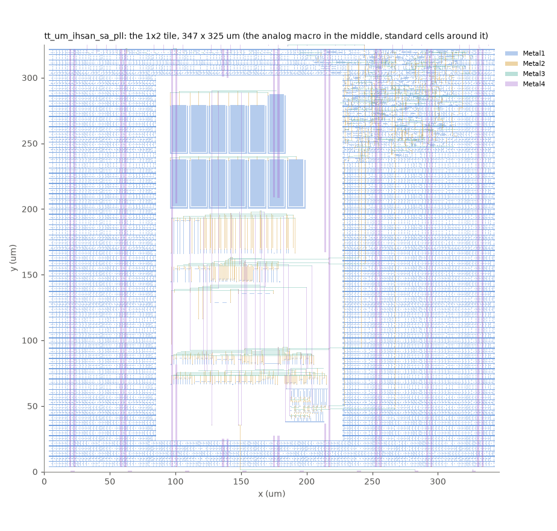
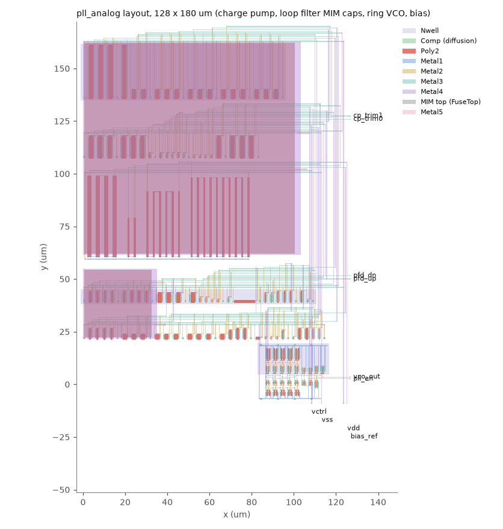
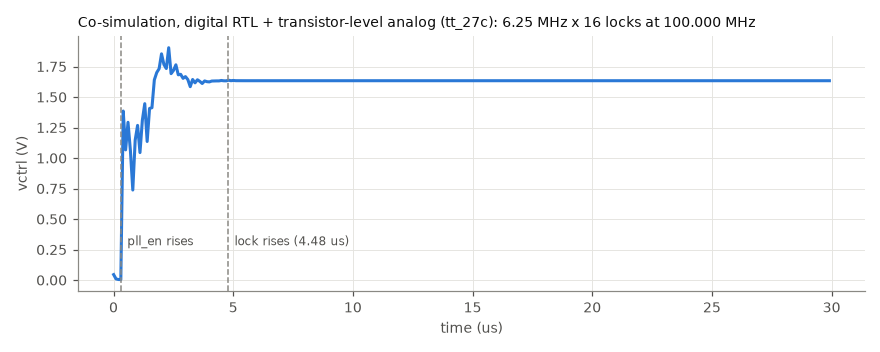
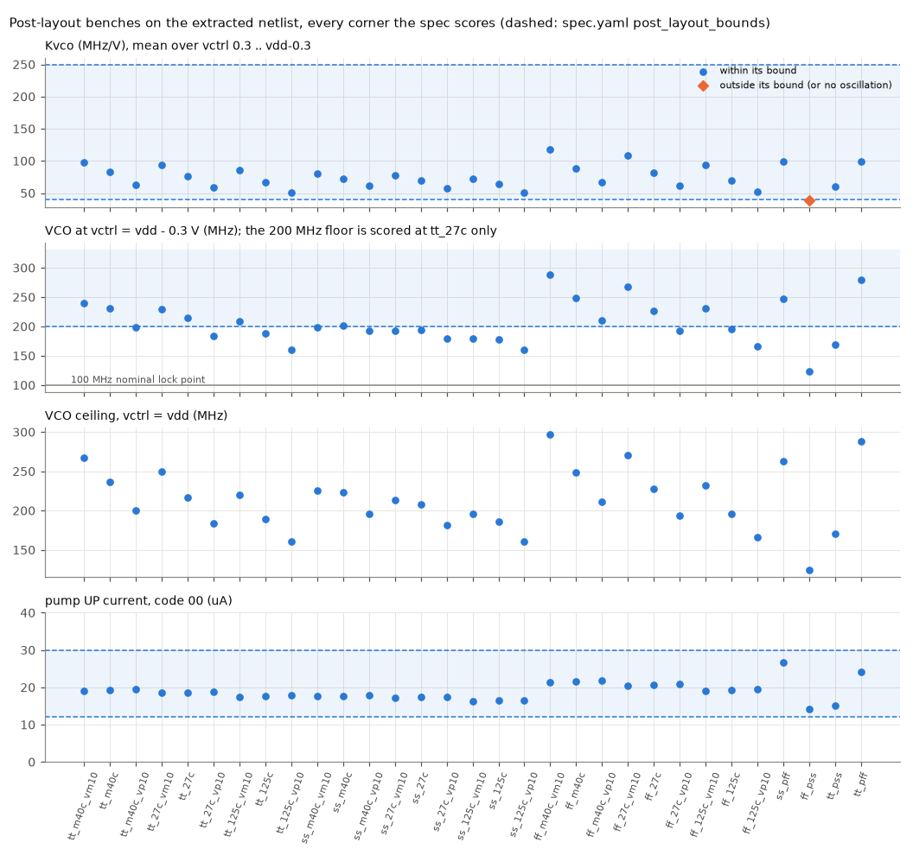

# Reviewing the PLL

One page for reviewing where the PLL stands, what it looks like, and which
decisions were taken without you, each marked as waiting for your review. You
said on 2026-10-29 (chat 261030-010852): "dont wait for me on anything. Just
build it all, i will retroactively review and tell you what to change or
redesign." So nothing below counts as approved by you. Each decision says what
was chosen, why, and what changing it would cost.

Each stage's gate, its recorded result and the one command to re-run or
view it are in [stages.md](stages.md) (`python3 docs/review/stages.py`
rewrites it from the recorded reports).

Regenerate the figures after any result changes:

    uv run --python 3.12 --no-project --with gdstk --with matplotlib python docs/review/make_figures.py

## Where it stands

| Stage | State | Evidence |
|---|---|---|
| Analog schematic, 31 PVT corners | signed off by you (H1-ada9eb); the loop filter's caps changed since (decision 0), resimulated at all 31 corners | `blocks/pll/analog/log/H1-signoff.md`, `blocks/pll/analog/reports/recorded/gate-sim_pvt.json` |
| Digital RTL: PFD, /8 prescaler, /N divider, lock detector, registers | done; sim, formal, coverage, mutation, holdout, standalone harden, DRC, LVS, precheck and gate-level sim pass | `blocks/pll/digital/state.json` |
| Whole loop in co-simulation (RTL + transistor-level analog) | done: locks at 100.000 MHz in 4.48 us; all three layers pass with the MOS caps | `blocks/pll/tb/README.md`, figure below |
| Digital timing with the VCO clock at each process's post-layout ceiling plus margin | met at every corner since 2026-10-31: the digital half clocks at vco/2 from a TSPC divider in the analog macro (decision 7); ss setup slack +2.34 ns, no waiver | `blocks/pll/digital/state.json` issue 8 |
| Analog layout | DRC clean, LVS unique match | `blocks/pll/analog/layout/` |
| Post-layout benches on the extracted netlist | 30 of 31 corners pass; ff_pss does not (below) | `blocks/pll/analog/reports/recorded/pex_pvt.json` |
| Full tile (digital hardened around the analog macro) | **done**: top_harden, top_drc (magic 0, klayout 0), top_lvs (unique match) | `gds/tt_um_ihsan_sa_pll.gds`, `blocks/pll/reports/recorded/` |
| Tiny Tapeout precheck | **passes**, both from chip-flow's gate and run on the committed `gds/`, `lef/`, `src/project.v` and `info.yaml` themselves | figure below |
| Repository in Tiny Tapeout's analog-project shape | **done**: `src/` (real top + RTL), `test/` (RTL test, 4/4), 1x2 analog `info.yaml`, `custom_gds` gds workflow | `blocks/pll/tt/README.md` |

Nothing is ever submitted to Tiny Tapeout or the course for you. "Ready for
submission" stops at: precheck passes on the committed GDS, and the repository
has the analog template's shape. Both hold now. What is still open is listed
at the bottom.

## What it looks like

### The tile

The 1x2 tile as committed in `gds/`: the analog macro in the middle, the
digital core's standard cells around it, and the Metal4 power stripes.

### The analog macro

Bottom to top, as `gen_pll_analog.py` draws it: the ring VCO (the small
block at the bottom right, under the vco_out pin); two rows of bias, buffer
and enable devices; the resistors' poly serpentines (R1, R_V2I and the bias
resistors, the tall red bars); the charge pump's NMOS row and its PMOS mirror
bank; and the two rows of MOS caps on top, C1 (12 units) and C2 (the
taller unit at the top right). Digital pins are on the right edge.
Supplies and the two analog pads (vctrl, bias_ref) are on the bottom edge.

To open it yourself: `klayout blocks/pll/analog/layout/pll_analog.gds`. The
generator that draws it is `blocks/pll/analog/layout/gen_pll_analog.py`.
GitHub Pages is on for the repository (warden request 261030-015628,
2026-10-30). Once this branch is on main, the gds workflow's viewer job
publishes a 3D viewer of the tile's GDS at
https://hive-rsi-lab.github.io/ece298a-pll/ on every push to main. To open
the tile yourself: `klayout gds/tt_um_ihsan_sa_pll.gds`.

### The loop locking

The loop locking on the transistor-level analog netlist, co-simulated with the
digital RTL. To watch it lock in a waveform viewer without any EDA tree, run
the RTL test of the real top (Icarus Verilog and cocotb). It uses a
behavioural model of the analog macro and takes about a second:

    cd test && make && gtkwave tb.fst   # or surfer tb.fst

### Post-layout, every corner

What fails, and why:

- **ff_pss**: Kvco reads 39.2 MHz/V against a 40 MHz/V floor (decision 3).
- ss_m40c_vm10 used to fail too: the bias reference settled in its second DC
  operating point (pump current 168 uA, no oscillation). Task 261030-001020's
  fix (MN_ST L 2 -> 4 um) is in this layout, and the corner passes
  (Icp 17.5 uA, Kvco 80.1 MHz/V).

One thing the figure shows that no bound catches: at ff_pss the VCO's ceiling
is about 115 MHz after layout (158 MHz before). Every corner still reaches the
100 MHz nominal point, but the lock range promised in `docs/info.md` (up to
about 200 MHz) only holds at typical. Decision 4 covers it.

## Decisions taken without you, waiting for your review

0. **The loop filter's capacitors are MOS caps, not MIM (a change to the
   netlist you signed off at H1).** Tiny Tapeout's precheck failed the tile
   with "KLayout Checks: Forbidden layer Metal5 found". Tiny Tapeout's GF180
   process has five metal layers with MIM option B, so a MIM cap's top plate
   is Metal5, and Metal5 is reserved for the shuttle. C1 and C2 are now
   `cap_nmos_03v3_b`: NMOS-in-nwell accumulation caps, about 3.98 fF/um2 at
   1.6 V.
   - C1: 420 x 12 um, as 12 units of 35 x 12 um, 20.1 pF. It was a
     100 x 100 um MIM, 20.0 pF.
   - C2: 43 x 12 um, 2.06 pF. It was a 32 x 32 um MIM, 2.05 pF.
   - Area: 5556 um2 of MOS cap against 11024 um2 of MIM. A MOS cap can't sit
     over the other devices the way the MIM did, though, so the macro grows
     from 128 x 180 um to 118 x 256 um. It still fits the 1x2 tile.
   - The capacitance falls below about 0.5 V on the gate: 3.6 fF/um2 at
     0.3 V, 9% under nominal. That only matters at the bottom of the tuning
     range (vctrl near 0.3 V, the lowest output frequencies). At the 100 MHz
     point, vctrl is about 1.6 V.
   - Results at each corner, before and after, are in the table below.
     Undoing it means another way to get 20 pF without Metal5, and none is
     as small.
   The phase margin moves by +0.1 to +0.3 deg and the post-layout VCO by up
   to about 1%. Every pre-layout bound passes at all 31 corners, before and
   after. Post-layout, the same two corners miss as before (ss_m40c_vm10,
   ff_pss).

   Since this table: the MN_ST fix is merged into this layout, and
   chip-flow's extraction stopped counting each net's coupling C twice
   (hive-chip-flow 3c085e6). Rebuilt with both (task 261030-101238),
   pex_pvt passes 30 of 31. ss_m40c_vm10 passes. ff_pss Kvco reads 39.2,
   and the VCO reads about 6% faster at every corner: tt_27c 215.3 MHz at
   vdd-0.3 V, Kvco 77.0 MHz/V. The current numbers per corner are in
   `blocks/pll/analog/reports/recorded/pex_pvt.json`. The table keeps the
   MIM-vs-MOS comparison on one extraction.

   Pre-layout (sim_pvt, every bound passes before and after), and post-layout (pex_pvt on the extracted netlist), MIM before / MOS after:

   | corner | phase margin, P*N=16 (deg) | post-layout Kvco (MHz/V) | post-layout f at vdd-0.3 V (MHz) | post-layout Icp up (uA) |
   |---|---|---|---|---|
   | tt_m40c_vm10 | 52.6 / 52.8 | 90.9 / 91.5 | 224.2 / 225.8 | 19.1 / 19.0 |
   | tt_m40c | 51.2 / 51.3 | 77.2 / 78.0 | 215.9 / 218.1 | 19.3 / 19.3 |
   | tt_m40c_vp10 | 48.2 / 48.4 | 58.8 / 59.8 | 184.7 / 188.0 | 19.5 / 19.3 |
   | tt_27c_vm10 | 51.6 / 51.8 | 87.2 / 87.7 | 215.0 / 216.2 | 18.6 / 18.5 |
   | tt_27c | 49.5 / 49.8 | 72.4 / 72.7 | 202.7 / 203.3 | 18.7 / 18.6 |
   | tt_27c_vp10 | 46.0 / 45.8 | 55.2 / 55.4 | 173.5 / 174.2 | 18.8 / 18.7 |
   | tt_125c_vm10 | 49.7 / 49.8 | 80.3 / 80.5 | 197.7 / 198.0 | 17.5 / 17.4 |
   | tt_125c | 46.8 / 47.0 | 64.6 / 64.0 | 180.9 / 179.2 | 17.6 / 17.6 |
   | tt_125c_vp10 | 43.1 / 43.3 | 49.5 / 48.9 | 155.8 / 154.0 | 17.8 / 17.8 |
   | ss_m40c_vm10 | 54.0 / 54.2 | 0.0 / 0.0 | 0.0 / 0.0 | 168.3 / 168.7 |
   | ss_m40c | 53.3 / 53.4 | 67.0 / 67.4 | 188.2 / 189.4 | 17.8 / 17.8 |
   | ss_m40c_vp10 | 52.1 / 52.2 | 57.1 / 57.7 | 179.4 / 181.2 | 18.0 / 17.9 |
   | ss_27c_vm10 | 53.4 / 53.6 | 72.6 / 73.0 | 180.4 / 181.2 | 17.1 / 17.1 |
   | ss_27c | 52.4 / 52.6 | 64.7 / 65.0 | 181.6 / 182.4 | 17.3 / 17.3 |
   | ss_27c_vp10 | 50.7 / 50.8 | 54.1 / 54.2 | 169.9 / 170.3 | 17.4 / 17.4 |
   | ss_125c_vm10 | 52.0 / 52.2 | 68.2 / 68.5 | 169.0 / 169.5 | 16.2 / 16.2 |
   | ss_125c | 51.4 / 51.6 | 60.1 / 60.2 | 168.5 / 168.7 | 16.5 / 16.4 |
   | ss_125c_vp10 | 48.3 / 48.5 | 49.0 / 48.5 | 154.0 / 152.5 | 16.6 / 16.7 |
   | ff_m40c_vm10 | 50.1 / 50.3 | 109.3 / 110.4 | 268.4 / 270.9 | 21.3 / 21.3 |
   | ff_m40c | 46.7 / 46.9 | 82.8 / 83.7 | 231.5 / 234.1 | 21.6 / 21.5 |
   | ff_m40c_vp10 | 42.9 / 43.1 | 62.1 / 63.2 | 195.3 / 198.6 | 21.9 / 21.8 |
   | ff_27c_vm10 | 48.4 / 48.5 | 101.8 / 102.8 | 249.9 / 252.2 | 20.6 / 20.5 |
   | ff_27c | 44.5 / 44.7 | 76.3 / 76.9 | 213.7 / 215.1 | 20.8 / 20.6 |
   | ff_27c_vp10 | 40.7 / 40.8 | 57.4 / 58.1 | 180.9 / 182.9 | 20.9 / 20.8 |
   | ff_125c_vm10 | 45.1 / 45.2 | 89.7 / 89.1 | 220.5 / 219.0 | 19.2 / 19.1 |
   | ff_125c | 40.9 / 41.0 | 66.7 / 66.5 | 187.1 / 186.3 | 19.4 / 19.3 |
   | ff_125c_vp10 | 37.2 / 37.3 | 50.2 / 50.8 | 158.4 / 160.1 | 19.8 / 19.6 |
   | ss_pff | 50.0 / 50.1 | 92.8 / 93.2 | 232.3 / 233.2 | 26.7 / 26.6 |
   | ff_pss | 43.3 / 43.5 | 36.1 / 37.1 | 113.9 / 116.9 | 14.0 / 13.9 |
   | tt_pss | 49.9 / 50.0 | 57.6 / 57.4 | 161.4 / 160.6 | 15.0 / 15.1 |
   | tt_pff | 49.2 / 49.4 | 93.2 / 93.9 | 261.1 / 262.8 | 24.2 / 24.1 |

1. **The analog layout goes ahead to the tile (H2-a9fad5).** The engine
   presented the layout sign-off as challenge H2-a9fad5 on 2026-10-28. It is
   not recorded as approved. The tile is built on this layout, and
   `blocks/pll/analog/log/H2-proceed.md` records that this was done pending
   your review. If you reject it, the layout is redone and the tile rebuilt.
2. **Digital issue 8, the ss_125C timing waiver (superseded 2026-10-31 by
   decision 7: the digital half now clocks at vco/2 and meets timing with
   margin, no waiver).** The VCO clock was
   constrained per process at its post-layout ceiling plus margin: 3.75 ns
   (267 MHz) at ss, 2.7 ns (370 MHz) at tt and ff. At ss_125C the /2
   prescaler stage misses setup by 0.15 ns, inside the 0.25 ns clock
   uncertainty (at a flat 2.7 ns it missed by 1.2 ns). No flop in the GF180
   library toggles at 2.7 ns at ss.
   It is waived at that corner because the VCO can't go that fast at ss:
   after layout, the fastest corner with slow transistors (ss_pff)
   reaches 263 MHz at the rail (247 before chip-flow's extraction fix),
   and the stage manages 274 MHz. A recovery circuit also pulls the loop back if it
   ever runs away. The approval on record is the lead's under your 10-28
   "i signoff" message, not your own ruling. Details are in issue 8 of
   `blocks/pll/digital/state.json`.
3. **ff_pss Kvco, 39.2 vs 40 MHz/V (open).** The 40 MHz/V floor protects loop
   gain, and through it the phase margin. The decision rests on the phase
   margin at ff_pss, not the Kvco number. The linear loop model (layer 1,
   `blocks/pll/tb/pll_loop_model.py`) with ff_pss's post-layout pump current
   (13.6 uA) and Kvco scaled to 36 MHz/V gives 31 deg at P*N = 16 with
   typical R1, and 27 to 35 deg over R1 +-15%. The spec's floor is 30 deg at
   every corner. That is too close to call on a scaled estimate, so it is
   settled on the extracted netlist, by one of:
   (a) keep the bound and raise Kvco at ff_pss (a smaller R_V2I, re-layout);
   (b) replace the bound by the post-layout phase margin at every corner,
   if that clears 30 deg.
   Until one of those runs, the bound stands and ff_pss counts as failing.
4. **The datasheet's lock range.** `docs/info.md` will promise only what every
   post-layout corner reaches: the VCO between about 12 and 114 MHz, so
   8 x N x f_ref between those, with 100 MHz as the nominal point. Typical
   silicon goes further (7 to 205 MHz).
5. **The tile is 1x2, not 1x1.** Tiny Tapeout's GF180 analog tiles start at
   1x2.
6. **PFD_UP and PFD_DN leave the debug pins in the full tile.** In the
   standalone digital harden, `uo[3]` and `uo[4]` show the PFD's UP and DN
   pulses. In the tile, chip-flow wires each crossing signal to the analog
   macro only, so `uo[3:7]` read 0. Keeping UP/DN visible needs a chip-flow
   change (a crossing signal that also goes to a pad). Say if you want it.

7. **A TSPC divide-by-2 inside the analog macro (a change to the netlist you
   signed off at H1; 2026-10-31, issue #48).** Digital issue 8 (decision 2)
   closed at the slow corner only by a few ps, with no margin, because a
   library flop had to toggle at the VCO's ceiling. Now a 9-transistor TSPC
   flop with D tied to its own output divides the VCO by 2 inside the macro,
   and the digital half clocks at vco/2 through a /4 prescaler. The overall
   ratio (/8) is unchanged.
   - Netlist: block 8 of `blocks/pll/analog/netlist/pll_analog.cir` (14
     devices, all L = 0.28 um), described in `analog/spec/topology.md`
     section 8. `MP_DR` holds the divider's state node high while `pll_en`
     is low, so standby stays static (standby current unchanged, about
     0.15 nA at tt).
   - Pins: the macro's output pin is `vco_div2`; `vco_out` is now an internal
     node, since chip-flow's tile harden requires the macro's pins to be
     exactly the interface's. The analog benches read it as `xdut.vco_out`.
   - Layout: the divider sits in the ring block, right of the output
     inverter. DRC clean, LVS unique match. Post-layout VCO ceilings moved
     at most 0.9% (296.9 MHz at ff_m40c_vm10, was 299.5), and all 31
     post-layout corners pass.
   - Digital timing (PR #50): setup slack at ss is +2.34 ns (it was -0.03
     to +0.004); the first stage would keep up with a VCO near 388 MHz at
     ss. The ss waiver is gone.
   - Cost of undoing it: revert block 8, the layout columns and the
     digital prescaler, and go back to decision 2's waiver.

## What is left

1. The ff_pss decision (3 above).
2. The gds, docs and test workflows passing on main with this design.
